# SPAT — Student Activity & Performance Tracker
## Product Requirements Document (PRD)

---

| Field | Value |
|---|---|
| Document Title | SPAT Product Requirements Document |
| Project Code Name | SAPT (Student Activity Point Tracker) |
| Version | 1.0 |
| Status | Draft — For Client Review |
| Prepared By | Antigravity (Senior PM / BA / Architect Analysis) |
| Date | October 2026 |
| Audience | Business Stakeholders, Development Team, Client |

---

## Version History

| Version | Date | Author | Summary of Changes |
|---|---|---|---|
| 0.1 | Oct 2026 | Analysis | Initial draft from codebase inspection |
| 1.0 | Oct 2026 | Analysis | Full PRD with all sections completed |

---

## Table of Contents

1. [Executive Summary](#1-executive-summary)
2. [Product Overview](#2-product-overview)
3. [Problem Statement](#3-problem-statement)
4. [Product Vision and Objectives](#4-product-vision-and-objectives)
5. [Target Audience and User Personas](#5-target-audience-and-user-personas)
6. [Stakeholders and User Roles](#6-stakeholders-and-user-roles)
7. [Product Scope and Boundaries](#7-product-scope-and-boundaries)
8. [Functional Modules and Features](#8-functional-modules-and-features)
9. [Detailed Functional Requirements](#9-detailed-functional-requirements)
10. [End-to-End User Workflows](#10-end-to-end-user-workflows)
11. [User Stories and Acceptance Criteria](#11-user-stories-and-acceptance-criteria)
12. [System Architecture](#12-system-architecture)
13. [Technology Stack](#13-technology-stack)
14. [API and Data Architecture](#14-api-and-data-architecture)
15. [Non-Functional Requirements](#15-non-functional-requirements)
16. [Security and Permissions](#16-security-and-permissions)
17. [Deployment and Operational Considerations](#17-deployment-and-operational-considerations)
18. [Risks, Dependencies, Assumptions, and Constraints](#18-risks-dependencies-assumptions-and-constraints)
19. [Current Implementation Gaps](#19-current-implementation-gaps)
20. [Proposed Future Enhancements](#20-proposed-future-enhancements)
21. [Product Success Metrics](#21-product-success-metrics)
22. [Open Questions for the Client](#22-open-questions-for-the-client)
23. [Glossary and Appendices](#23-glossary-and-appendices)

---

## 1. Executive Summary

SPAT (Student Activity & Performance Tracker) — internally codenamed **SAPT** — is an enterprise-grade, multi-tenant web platform designed to digitise and streamline the management of student extracurricular activity points in higher education institutions.

The platform provides a **five-tier role hierarchy** (System Administrator → College Administrator → Head of Department → Mentor → Student) with purpose-built dashboards and workflows for each role. Students submit evidence of activities such as hackathons, internships, certifications, and cultural events; mentors review and award credit points; and administrators gain real-time visibility into institutional performance through comprehensive analytics dashboards.

**Key findings from codebase inspection (October 2026):**

- The backend (Spring Boot 3.2.5 + PostgreSQL + MongoDB + JWT) is **substantially implemented** across all five role modules, the submission pipeline, the notification system, and the mentor succession workflow.
- The frontend (React 19 + Vite + Tailwind CSS) has full routing, all five role dashboards, and all major page components implemented.
- The platform is **deployment-ready on cloud infrastructure** (Render for backend via Docker, Vercel for frontend).
- Identified gaps: the standalone `SubmissionController` has only a file-download endpoint (submission CRUD is correctly delegated through `StudentController` and `MentorController`); the `ReviewController` appears to be a separate ratings/testimonial module, not the submission review workflow; automated testing coverage is not visible in the inspected codebase.

---

## 2. Product Overview

### 2.1 What Is SPAT?

SPAT is a **college management and student performance tracking system** that replaces paper-based or spreadsheet-driven processes for recording student extracurricular achievements. It provides a unified digital platform where:

- Students log and submit proof of activities (hackathons, internships, research papers, certifications, cultural events, sports, etc.).
- Mentors review submitted evidence and award credit points, which contribute to a student's overall performance score.
- Heads of Department, College Administrators, and a System Administrator gain hierarchical visibility into performance, trends, and engagement metrics.

### 2.2 Business Purpose

Many Indian engineering and arts colleges are required by regulatory bodies (such as AICTE, UGC, and affiliated universities) to track student co-curricular and extracurricular activities as part of graduation criteria. Currently, most institutions rely on manual registers, Excel sheets, or ad-hoc email submissions — creating administrative burden, data inconsistency, and a lack of real-time insight.

SPAT solves this by providing a **SaaS-style multi-college platform** where a single System Administrator onboards multiple partner colleges, each managing their own users and data in an isolated, role-controlled environment.

### 2.3 Value Proposition

| Stakeholder | Value Delivered |
|---|---|
| Student | Single portal to record achievements, track credit totals, earn badge levels, and receive feedback |
| Mentor | Structured review queue with approve/reject controls and automated credit calculation |
| HOD | Real-time department analytics: placement readiness factors, top performers, skill trends |
| College Admin | College-wide dashboard with department breakdowns, mentor performance, monthly trends |
| System Admin | Multi-college oversight, college lifecycle management (onboard, activate, suspend) |
| Institution | Regulatory compliance data, reduced admin overhead, improved student engagement visibility |

---

## 3. Problem Statement

### 3.1 Current Challenges

1. **Manual and paper-based tracking**: Students submit physical certificates or email attachments with no centralised system for review or audit.
2. **No real-time visibility**: Department heads and college administrators cannot see current student engagement without individually collecting data from each mentor.
3. **Inconsistent credit calculation**: Point awards vary between mentors with no standardised criteria or category framework.
4. **No student motivation mechanism**: Students lack gamified feedback such as star levels or rankings to encourage continued participation.
5. **Faculty succession gaps**: When a mentor or HOD changes, student assignment records are lost or manually transferred.
6. **Regulatory reporting difficulty**: Generating activity point reports for AICTE or university audits requires manual compilation from scattered records.

### 3.2 Impact

Without a system like SPAT, institutions risk regulatory non-compliance, inequitable credit distribution, faculty workload imbalance, and inability to identify high-performing students for placement or scholarship recommendations.

---

## 4. Product Vision and Objectives

### 4.1 Vision Statement

> *"To be the definitive digital platform that empowers every Indian higher-education institution to recognise, reward, and report student co-curricular achievement with fairness, transparency, and zero administrative overhead."*

### 4.2 Strategic Objectives

| ID | Objective | Priority |
|---|---|---|
| OBJ-01 | Provide a fully digital, role-stratified activity-point submission and review pipeline | High |
| OBJ-02 | Deliver real-time analytics dashboards at all administrative levels | High |
| OBJ-03 | Support multiple colleges under a single platform (multi-tenancy) | High |
| OBJ-04 | Gamify student achievement through credit-based star/badge levels | Medium |
| OBJ-05 | Enable structured faculty succession to preserve institutional continuity | Medium |
| OBJ-06 | Provide email-based OTP authentication for secure, password-reset-capable access | High |
| OBJ-07 | Support file-based submission evidence (documents, images) via MongoDB storage | High |

---

## 5. Target Audience and User Personas

### Persona 1 — Priya (Student, 20)
> Third-year CSE student who participates in hackathons and online certifications. Wants to track all her activities in one place, see how many credits she has earned, and understand what she needs to reach the next star level.

**Goals:** Submit activity proofs quickly, track credit history, view mentor feedback, maintain a daily learning log.

**Pain Points:** Uncertainty about whether a submission was seen; no single view of total achievement; confusion about what categories qualify.

---

### Persona 2 — Prof. Sharma (Mentor, 38)
> Faculty member assigned to 25 students. Reviews 5–10 activity submissions per week and wants a clear pending queue with enough context to make quick, fair decisions.

**Goals:** See all pending submissions at a glance, approve/reject with a comment, view individual student performance.

**Pain Points:** Receiving submissions via WhatsApp or email; no audit trail; difficulty tracking which students are inactive.

---

### Persona 3 — Dr. Rao (Head of Department, 52)
> HOD of the Mechanical Engineering department. Needs to understand overall department activity levels, approve new mentors, and identify students at risk for low engagement.

**Goals:** Department-level analytics, mentor oversight, approval of new mentor registrations.

**Pain Points:** Manual compilation of monthly activity reports; no view of which mentor is most/least effective.

---

### Persona 4 — Ms. Kavitha (College Administrator, 45)
> Administrative head of a private engineering college. Manages HODs across departments and is accountable to the college management for student outcome reporting.

**Goals:** College-wide analytics, HOD management, department comparison, placement readiness metrics.

**Pain Points:** No real-time dashboard; dependent on manual reports from individual departments.

---

### Persona 5 — Admin (System Administrator)
> Platform operator at the software company (Intouract Spark). Onboards new partner colleges, manages the platform health, and resolves escalations.

**Goals:** Onboard colleges, assign college admins, view system-wide KPIs, suspend/activate colleges.

**Pain Points:** Manual onboarding emails, no single platform overview.

---

## 6. Stakeholders and User Roles

*Verified against `UserRole.java`, `SecurityConfig.java`, and all controller `@PreAuthorize` annotations.*

### 6.1 Role Hierarchy

```
SYSTEM_ADMIN
    └── COLLEGE_ADMIN
            └── HOD
                    └── MENTOR
                              └── STUDENT
```

### 6.2 Role Definitions

| Role | System Name | Scope | Created By |
|---|---|---|---|
| System Administrator | `SYSTEM_ADMIN` | Entire platform | Pre-seeded |
| College Administrator | `COLLEGE_ADMIN` | One college | System Admin |
| Head of Department | `HOD` | One department within a college | Self-register → Approved by College Admin (TBC) |
| Mentor | `MENTOR` | Students assigned in one department | Self-register → Approved by HOD |
| Student | `STUDENT` | Own submissions and logs | Self-register → Status set to PENDING |

### 6.3 User Status Lifecycle

*From `UserStatus` enum and `User.java`:*

```
PENDING → APPROVED → (active, can log in)
PENDING → REJECTED → (denied access)
```

- Staff accounts created directly by admins are set to `APPROVED` immediately.
- Student self-registrations start as `PENDING`; a mentor (or HOD) approves them.
- All accounts have an `is_active` soft-delete flag.

---

## 7. Product Scope and Boundaries

### 7.1 In Scope (Implemented or Partially Implemented)

| # | Module |
|---|---|
| 1 | Multi-college platform onboarding and management |
| 2 | JWT-based authentication with OTP email verification |
| 3 | Five-role RBAC with role-specific dashboards |
| 4 | Student activity submission pipeline (create, view, resubmit) |
| 5 | Mentor review workflow (approve/reject with credit award) |
| 6 | Credit penalty system (10% deduction on rejection) |
| 7 | Student credit snapshot and star/badge gamification |
| 8 | Daily log creation and mentor remarks |
| 9 | HOD analytics dashboard and mentor approval |
| 10 | College Admin analytics dashboard |
| 11 | System Admin college and admin management |
| 12 | In-app notification system |
| 13 | Email notification via SMTP |
| 14 | Mentor succession request workflow |
| 15 | File upload/download for submission evidence (MongoDB) |
| 16 | Profile management for all roles |
| 17 | Custom activity category creation |

### 7.2 Out of Scope

| # | Feature | Notes |
|---|---|---|
| 1 | Mobile native application (iOS/Android) | Web-only |
| 2 | LMS integration (Moodle, Canvas) | Not planned |
| 3 | Automated AICTE/University report generation | Proposed future |
| 4 | Payment / subscription billing | Proposed future |
| 5 | Video evidence upload streaming | TBC |
| 6 | Real-time chat between mentor and student | Not implemented |
| 7 | Student peer review of submissions | Not implemented |

---

## 8. Functional Modules and Features

### 8.1 Module Map

| Module ID | Module Name | Primary Role(s) |
|---|---|---|
| MOD-01 | Authentication & User Management | All roles |
| MOD-02 | System Administration | SYSTEM_ADMIN |
| MOD-03 | College Administration | COLLEGE_ADMIN |
| MOD-04 | Department Management (HOD) | HOD |
| MOD-05 | Mentor Management | MENTOR |
| MOD-06 | Student Activity Tracking | STUDENT |
| MOD-07 | Submission Review Pipeline | MENTOR, HOD |
| MOD-08 | Credit & Gamification Engine | STUDENT (view), MENTOR (award) |
| MOD-09 | Daily Log System | STUDENT, MENTOR |
| MOD-10 | Notification System | All roles |
| MOD-11 | Succession Management | MENTOR, HOD |
| MOD-12 | Analytics & Reporting | COLLEGE_ADMIN, HOD, MENTOR |
| MOD-13 | Profile Management | All roles |
| MOD-14 | Review / Testimonials | Public (TBC) |

---

## 9. Detailed Functional Requirements

### MOD-01: Authentication & User Management

| FR ID | Requirement | Status |
|---|---|---|
| FR-001 | Users shall log in with email + password + role selection | Implemented |
| FR-002 | New users shall register with name, email, password, college, department, and role | Implemented |
| FR-003 | System shall send an OTP to the registered email for verification | Implemented |
| FR-004 | Users shall be able to request a new OTP if the previous one expired | Implemented |
| FR-005 | Users shall verify the OTP before their account becomes usable | Implemented |
| FR-006 | Users shall be able to reset their password using a valid OTP | Implemented |
| FR-007 | The system shall issue a JWT Bearer token on successful login | Implemented |
| FR-008 | JWT tokens shall expire after a configurable period (default: 86400000 ms / 24 hours) | Implemented |
| FR-009 | On token expiry or 401/403 response, the frontend shall auto-logout and redirect | Implemented |
| FR-010 | Staff accounts (HOD, Mentor) shall have PENDING status until approved by supervisor | Implemented |
| FR-011 | System Admin and College Admin accounts shall be set APPROVED on creation | Implemented |
| FR-012 | A separate admin login path (`/admin-login`) shall serve SYSTEM_ADMIN and COLLEGE_ADMIN roles | Implemented |
| FR-013 | User profiles shall store: name, email, phone, position, avatar URL, ID card URL | Implemented |
| FR-014 | Profile updates shall regenerate a fresh JWT token with updated claims | Implemented |

### MOD-02: System Administration

| FR ID | Requirement | Status |
|---|---|---|
| FR-020 | System Admin shall create a new college by providing name, state, address, contact, contract dates | Implemented |
| FR-021 | System Admin shall create a College Admin account simultaneously with the college | Implemented |
| FR-022 | System Admin shall list all registered colleges with their admin and status details | Implemented |
| FR-023 | System Admin shall view the detail of any single college | Implemented |
| FR-024 | System Admin shall update a college's status: ACTIVE, INACTIVE, SUSPENDED | Implemented |
| FR-025 | System Admin shall view all college admin accounts across the platform | Implemented |
| FR-026 | System Admin shall view system-wide KPI statistics (total colleges, users, submissions) | Implemented |
| FR-027 | System Admin shall view and update their own profile | Implemented |

### MOD-03: College Administration

| FR ID | Requirement | Status |
|---|---|---|
| FR-030 | College Admin shall view a college-wide analytics dashboard (user counts, submission breakdown, top students, top mentors, department charts, monthly trends, placement readiness factors) | Implemented |
| FR-031 | College Admin shall view all departments within their college with HOD info and stats | Implemented |
| FR-032 | College Admin shall list users by role within the college (HOD, MENTOR, STUDENT) | Implemented |
| FR-033 | College Admin shall view and update their own profile | Implemented |
| FR-034 | College Admin shall update college address and official email | Implemented |
| FR-035 | College Admin page shall show a list of HOD succession/approval requests (front-end: `hod-requests` page) | Partially Implemented — frontend route exists; backend endpoint not found in `CollegeAdminController` |

### MOD-04: HOD Management

| FR ID | Requirement | Status |
|---|---|---|
| FR-040 | HOD shall view a department analytics dashboard (mentor/student totals, placement factors, bar charts, skill trend area chart, top 3 students, top 3 mentors) | Implemented |
| FR-041 | HOD shall view all APPROVED mentors in the department | Implemented |
| FR-042 | HOD shall view and action PENDING mentor registration requests | Implemented |
| FR-043 | HOD shall view and update their own profile | Implemented |

### MOD-05: Mentor Management

| FR ID | Requirement | Status |
|---|---|---|
| FR-050 | Mentor shall view a dashboard: total students, total credits, approve/reject/pending counts, success rate, top students, factor counts, monthly skill trend, recent pending submissions | Implemented |
| FR-051 | Mentor shall view their list of assigned students | Implemented |
| FR-052 | Mentor shall view all submissions for a specific assigned student | Implemented |
| FR-053 | Mentor shall view the pending submission queue | Implemented |
| FR-054 | Mentor shall approve a submission and set the awarded credits | Implemented |
| FR-055 | Mentor shall reject a submission with a review comment; system applies 10% credit penalty | Implemented |
| FR-056 | Mentor shall submit a succession request to hand over their account to a new faculty member | Implemented |
| FR-057 | Mentor shall cancel a pending succession request | Implemented |
| FR-058 | Mentor shall view daily logs from all assigned students | Implemented |
| FR-059 | Mentor shall add a remark/review to a student's daily log entry | Implemented |
| FR-060 | Mentor shall view and update their own profile | Implemented |
| FR-061 | Frontend shows a "Student Approvals" page (`/dashboard/mentor/student-approvals`) | Partially Implemented — frontend route exists; dedicated backend endpoint not found |

### MOD-06: Student Activity Tracking

| FR ID | Requirement | Status |
|---|---|---|
| FR-060 | Student shall view dashboard: total credits, star level/badge, submission counts, credit breakdown charts | Implemented |
| FR-061 | Student shall view a list of all available activity categories and sub-types | Implemented |
| FR-062 | Student shall create a new activity submission: category, sub-type, title, description, activity date, file attachments | Implemented |
| FR-063 | Student shall view their submission history with status (pending/approved/rejected) | Implemented |
| FR-064 | Student shall create a custom activity category if no existing category fits | Implemented |
| FR-065 | Student shall create a daily log entry with title, description, reference links, and log date | Implemented |
| FR-066 | Student shall update/resubmit a rejected or existing daily log entry | Implemented |
| FR-067 | Student shall view their daily log history including mentor remarks | Implemented |
| FR-068 | Student shall view the review/feedback on their submissions | Implemented |
| FR-069 | Student shall view and update their own profile | Implemented |

### MOD-07: Submission Review Pipeline

| FR ID | Requirement | Status |
|---|---|---|
| FR-070 | Submission shall have three states: PENDING, APPROVED, REJECTED | Implemented |
| FR-071 | On approval, mentor sets awarded credits (defaulting to suggested credits from sub-type) | Implemented |
| FR-072 | On rejection, system computes credit penalty = ceil(suggestedCredits × 10%) | Implemented |
| FR-073 | Rejected submissions may be resubmitted; `is_resubmission` flag and `parent_submission_id` track lineage | Implemented |
| FR-074 | Submissions store file attachments in MongoDB via `MongoSubmissionFile` | Implemented |
| FR-075 | File download endpoint is accessible without authentication | Implemented (by SecurityConfig) |
| FR-076 | Submission `withdrawSubmission` method is defined in service interface | Partially Implemented — service interface method exists; no controller endpoint found |

### MOD-08: Credit & Gamification Engine

| FR ID | Requirement | Status |
|---|---|---|
| FR-080 | System shall maintain a `StudentCreditSnapshot` record per student (total credits, approved/rejected/pending counts, star level, badge) | Implemented |
| FR-081 | On submission approval: snapshot's `totalCredits` and `totalApproved` shall be updated | Implemented |
| FR-082 | On submission rejection: `creditPenalty` shall be subtracted from total; `totalRejected` incremented | Implemented |
| FR-083 | Star levels: 0=Beginner (<100), 1=Bronze (100+), 2=Silver (250+), 3=Gold (500+), 4=Platinum (1000+), 5=Diamond (2000+) | Implemented |
| FR-084 | Star thresholds shall be configurable in the `star_thresholds` database table without code changes | Implemented |

### MOD-09: Daily Log System

| FR ID | Requirement | Status |
|---|---|---|
| FR-090 | Student shall create daily log entries with title, description, optional reference links, and log date | Implemented |
| FR-091 | Mentor shall view all daily logs from assigned students | Implemented |
| FR-092 | Mentor shall add a remark and update review_status on any log entry | Implemented |
| FR-093 | Daily logs are not subject to approve/reject credit workflow — mentor comment only | Implemented |

### MOD-10: Notification System

| FR ID | Requirement | Status |
|---|---|---|
| FR-100 | System shall create in-app notification records in the `notifications` table | Implemented |
| FR-101 | Users shall receive in-app notifications listing all notifications ordered newest-first | Implemented |
| FR-102 | Users shall see an unread notification count (bell badge) | Implemented |
| FR-103 | Users shall mark a single notification as read | Implemented |
| FR-104 | Users shall mark all notifications as read at once | Implemented |
| FR-105 | System shall send email notifications via SMTP (Gmail) for OTP and account events | Implemented |

### MOD-11: Succession Management

| FR ID | Requirement | Status |
|---|---|---|
| FR-110 | Mentor shall submit a succession request providing: candidate name, email, phone, and temporary password | Implemented |
| FR-111 | Succession request status: PENDING → APPROVED / REJECTED / CANCELLED | Implemented |
| FR-112 | Reviewer for MENTOR succession is the HOD; reviewer for HOD succession is College Admin | Implemented (per entity documentation) |
| FR-113 | On approval, outgoing user account credentials are transferred to the candidate | Implemented (per entity documentation) |
| FR-114 | Outgoing mentor can cancel a pending succession request | Implemented |

---

## 10. End-to-End User Workflows

### Workflow 1: Student Registration and Email Verification

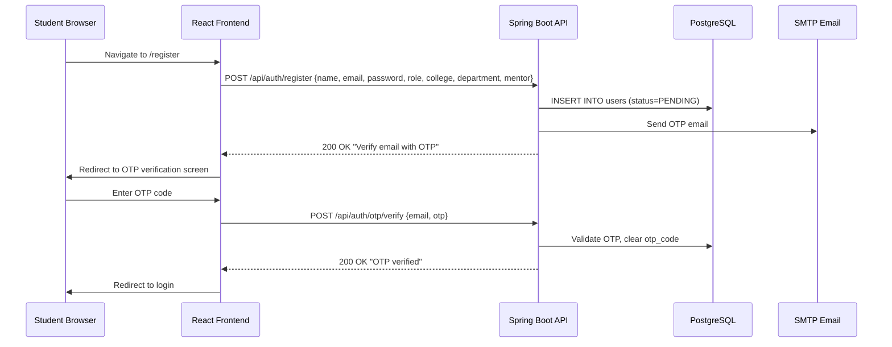

### Workflow 2: Login and Dashboard Routing

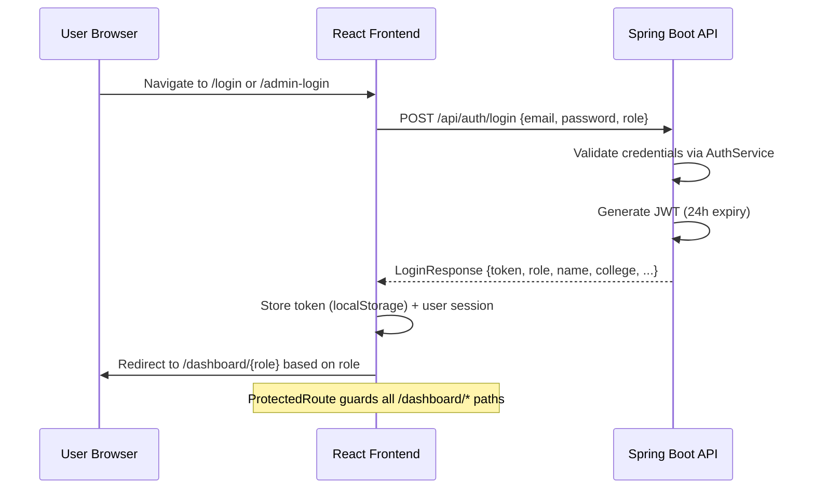

### Workflow 3: Student Submits an Activity

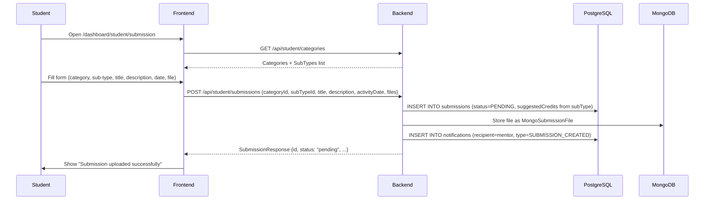

### Workflow 4: Mentor Reviews a Submission

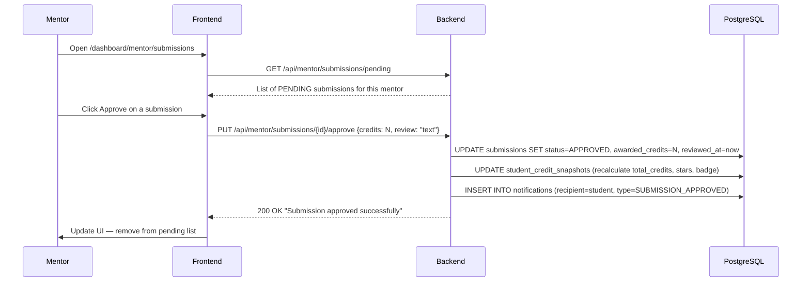

### Workflow 5: Rejection with Credit Penalty

```mermaid
flowchart TD
    A[Mentor clicks Reject] --> B[POST /api/mentor/submissions/{id}/reject]
    B --> C{Compute penalty}
    C --> D["penalty = ceil(suggestedCredits × 0.10)"]
    D --> E[UPDATE submission: status=REJECTED, awarded_credits=0, credit_penalty=penalty]
    E --> F[Recalculate StudentCreditSnapshot: totalCredits -= penalty]
    F --> G[INSERT Notification to Student]
    G --> H[Student receives rejection notification]
    H --> I{Student decides}
    I --> |Resubmit| J[POST /api/student/submissions with is_resubmission=true, parent_submission_id=originalId]
    I --> |Accept rejection| K[No further action]
```

### Workflow 6: Mentor Succession

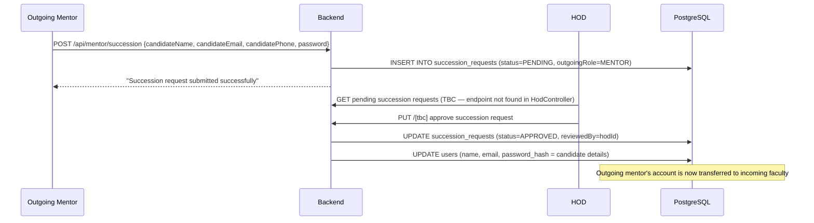

### Workflow 7: System Admin Onboards a New College

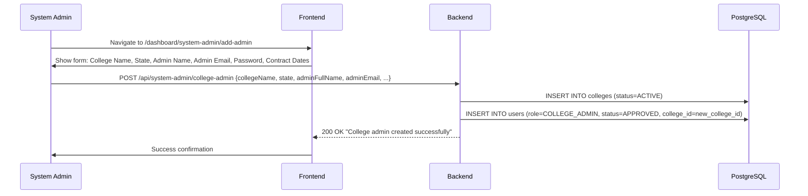

---

## 11. User Stories and Acceptance Criteria

| Story ID | Role | User Story | Acceptance Criteria |
|---|---|---|---|
| US-001 | Student | As a student, I want to submit evidence of a hackathon I won, so that I can earn credit points. | Submission created with status=PENDING; mentor receives notification; submission appears in student's history |
| US-002 | Student | As a student, I want to track my total credits and see what badge level I have reached, so that I can stay motivated. | Dashboard shows total credits, star count (0–5), badge name (Beginner to Diamond) |
| US-003 | Student | As a student, I want to write a daily log of what I studied, so that my mentor can give feedback. | Log entry created with title, description, date; appears in mentor's log view |
| US-004 | Mentor | As a mentor, I want to see all pending submissions, so that I can review them efficiently. | GET /api/mentor/submissions/pending returns only PENDING submissions for this mentor's students |
| US-005 | Mentor | As a mentor, I want to reject an invalid submission with a comment, so that the student understands the reason. | Submission status=REJECTED; review text stored; 10% credit penalty applied; notification sent to student |
| US-006 | HOD | As an HOD, I want to see a dashboard of my department's performance, so that I can identify underperforming students. | Dashboard shows mentor count, student count, top 3 students, monthly skill trend, category breakdown |
| US-007 | HOD | As an HOD, I want to approve new mentor registrations, so that only verified faculty can join. | GET /api/hod/mentor-approvals returns PENDING mentors; status update changes them to APPROVED |
| US-008 | College Admin | As a college admin, I want to view all departments and their activity metrics, so that I can compare departmental performance. | GET /api/college-admin/departments returns list with HOD info, mentor/student counts, activity stats |
| US-009 | System Admin | As a system admin, I want to onboard a new college and assign its admin, so that the college can start using the platform. | POST /api/system-admin/college-admin creates college + admin user; admin receives credentials |
| US-010 | System Admin | As a system admin, I want to suspend a college that is overdue on contract, so that its users cannot log in. | PUT /api/system-admin/colleges/{id}/status with status=SUSPENDED; college record updated |

---

## 12. System Architecture

### 12.1 High-Level Architecture

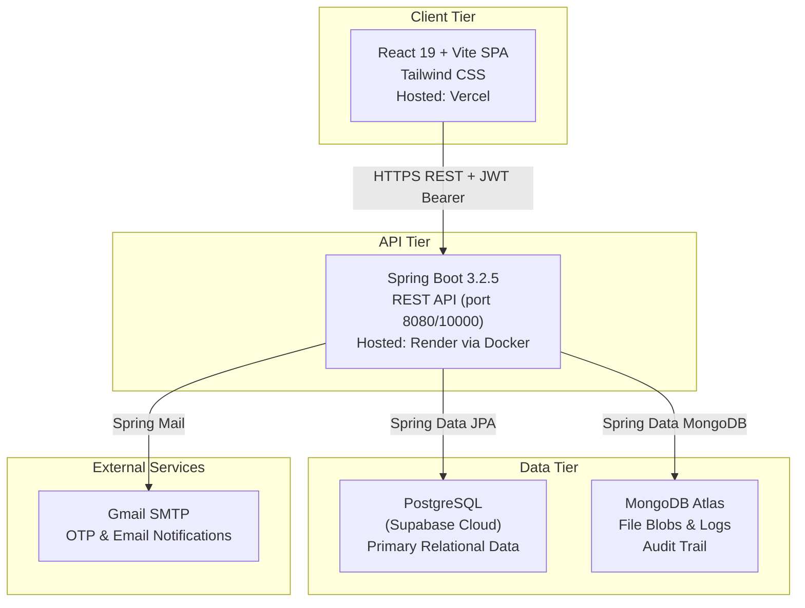

### 12.2 Frontend Architecture

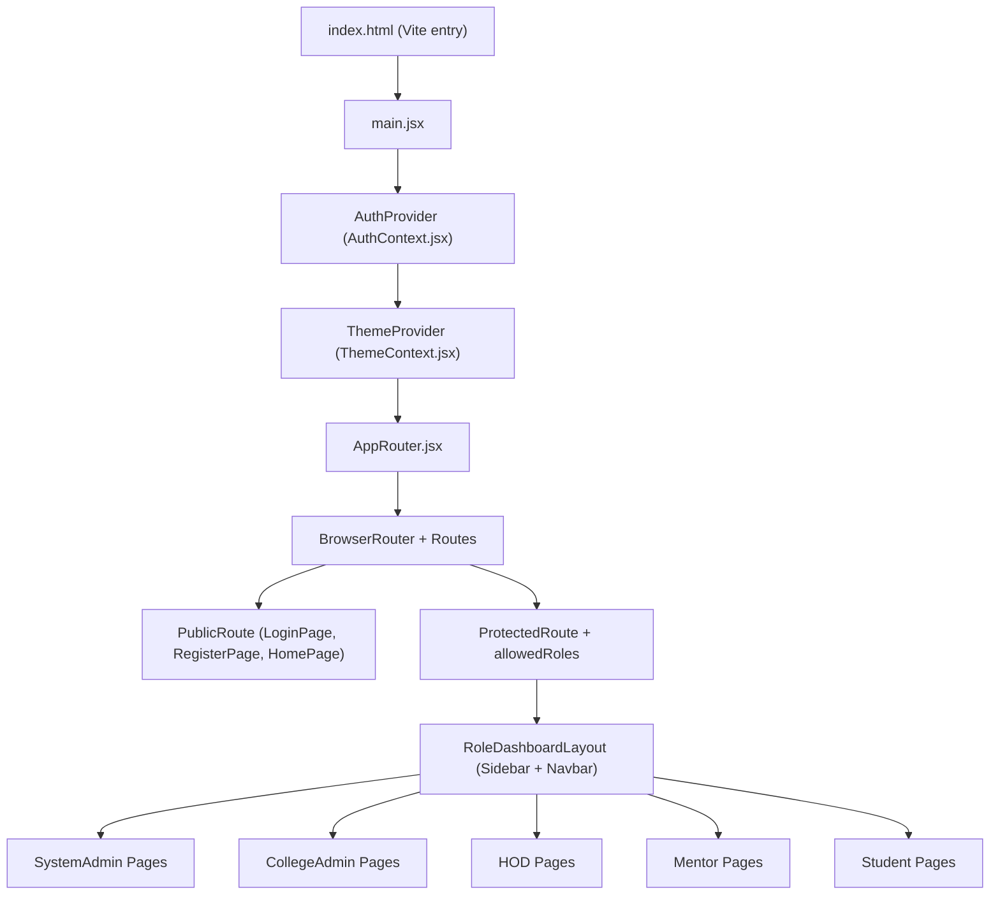

### 12.3 Backend Package Architecture

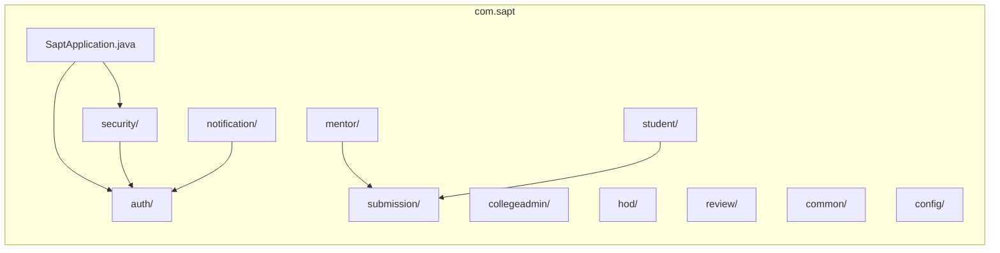

### 12.4 Security Architecture

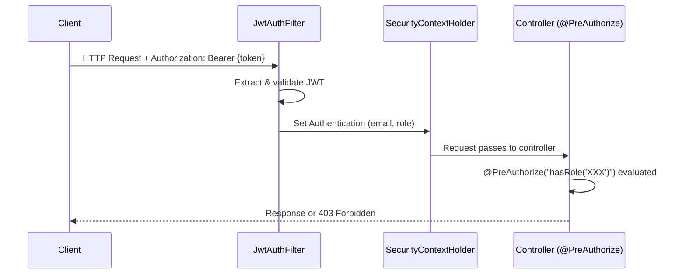

---

## 13. Technology Stack

| Layer | Technology | Version | Purpose |
|---|---|---|---|
| Frontend Framework | React | 19.2.6 | UI component system |
| Frontend Build Tool | Vite | 8.0.12 | Dev server and bundler |
| Frontend Styling | Tailwind CSS | 3.4.19 | Utility-first CSS framework |
| Frontend Routing | React Router DOM | 7.15.1 | Client-side routing and protected routes |
| Frontend Charts | Recharts | 3.8.1 | Dashboard analytics charts |
| Frontend Icons | Lucide React | 1.16.0 | Icon library |
| Frontend Deployment | Vercel | - | SPA hosting with SPA rewrites |
| Backend Framework | Spring Boot | 3.2.5 | REST API platform |
| Backend Language | Java | 17 | Application language |
| Backend Build | Maven | 3.8+ | Dependency management and build |
| Primary Database | PostgreSQL (Supabase) | - | Relational data (users, submissions, etc.) |
| Secondary Database | MongoDB Atlas | - | File storage, logs, audit trail |
| Authentication | JJWT | 0.11.5 | JWT generation and validation |
| Email | Spring Mail + Gmail SMTP | - | OTP and notification emails |
| Security | Spring Security | 6.x (via Boot 3.2) | RBAC, CSRF, CORS, stateless sessions |
| ORM | Spring Data JPA + Hibernate | - | PostgreSQL ORM layer |
| MongoDB Client | Spring Data MongoDB | - | MongoDB document operations |
| Config Management | dotenv-java | 3.0.0 | .env file loading at runtime |
| Boilerplate | Lombok | - | Getter/Setter/Builder code generation |
| Validation | Spring Validation (Jakarta) | - | DTO input validation |
| Backend Deployment | Render (Docker) | - | Cloud container hosting |
| Containerization | Docker (multi-stage) | - | Maven build + JRE 17 Alpine runtime |

---

## 14. API and Data Architecture

### 14.1 API Endpoints Summary

> **Base URL:** `https://{backend-host}/api`
> All protected endpoints require `Authorization: Bearer {jwt_token}` header.
> All responses use the `ApiResponse<T>` wrapper: `{success, message, data, timestamp}`.

#### Authentication Module (`/api/auth`)

| Method | Endpoint | Auth | Description |
|---|---|---|---|
| POST | `/api/auth/login` | Public | Login with email + password + role |
| POST | `/api/auth/register` | Public | Register new account (sends OTP) |
| POST | `/api/auth/otp/send` | Public | Request OTP for email or password reset |
| POST | `/api/auth/otp/verify` | Public | Verify OTP code |
| POST | `/api/auth/password/reset` | Public | Reset password with valid OTP |
| POST | `/api/auth/logout` | Public | Client-side token invalidation |
| GET | `/api/auth/colleges` | Public | List all colleges (for registration form) |
| GET | `/api/auth/colleges/departments` | Public | Get departments for a college |
| GET | `/api/auth/mentors` | Public | Get mentors for a college+department |
| GET | `/api/auth/users` | Auth | Get users by college and role |
| GET | `/api/auth/users/mentor/{mentorId}` | Auth | Get students assigned to mentor |
| POST | `/api/auth/users/{userId}/status` | Auth | Update user status |
| PUT | `/api/auth/users/{userId}/profile` | Auth | Update user profile and regenerate token |

#### System Admin Module (`/api/system-admin`)

| Method | Endpoint | Auth | Description |
|---|---|---|---|
| GET | `/api/system-admin/profile` | SYSTEM_ADMIN | Get system admin profile |
| PUT | `/api/system-admin/profile` | SYSTEM_ADMIN | Update profile |
| POST | `/api/system-admin/college-admin` | SYSTEM_ADMIN | Create college + admin account |
| GET | `/api/system-admin/colleges` | SYSTEM_ADMIN | List all colleges |
| GET | `/api/system-admin/colleges/{id}` | SYSTEM_ADMIN | Get single college |
| PUT | `/api/system-admin/colleges/{id}/status` | SYSTEM_ADMIN | Update college status |
| GET | `/api/system-admin/college-admins` | SYSTEM_ADMIN | List all college admins |
| GET | `/api/system-admin/stats` | SYSTEM_ADMIN | System-wide KPI stats |

#### College Admin Module (`/api/college-admin`)

| Method | Endpoint | Auth | Description |
|---|---|---|---|
| GET | `/api/college-admin/profile` | COLLEGE_ADMIN | Get profile |
| PUT | `/api/college-admin/profile` | COLLEGE_ADMIN | Update profile |
| PUT | `/api/college-admin/college` | COLLEGE_ADMIN | Update college address/email |
| GET | `/api/college-admin/dashboard` | COLLEGE_ADMIN | College analytics stats |
| GET | `/api/college-admin/departments` | COLLEGE_ADMIN | All departments with stats |
| GET | `/api/college-admin/users?role=X` | COLLEGE_ADMIN | Users filtered by role in college |

#### HOD Module (`/api/hod`)

| Method | Endpoint | Auth | Description |
|---|---|---|---|
| GET | `/api/hod/dashboard` | HOD | Department analytics stats |
| GET | `/api/hod/profile` | HOD | Get profile |
| GET | `/api/hod/mentors` | HOD | Approved mentors in department |
| GET | `/api/hod/mentor-approvals` | HOD | Pending mentor registrations |

#### Mentor Module (`/api/mentor`)

| Method | Endpoint | Auth | Description |
|---|---|---|---|
| GET | `/api/mentor/profile` | MENTOR | Get profile |
| GET | `/api/mentor/dashboard` | MENTOR | Mentor analytics dashboard |
| GET | `/api/mentor/students` | MENTOR | Assigned students list |
| GET | `/api/mentor/students/{studentId}/submissions` | MENTOR | Submissions for specific student |
| GET | `/api/mentor/submissions/pending` | MENTOR | All pending submissions |
| PUT | `/api/mentor/submissions/{id}/approve` | MENTOR | Approve submission with credits |
| PUT | `/api/mentor/submissions/{id}/reject` | MENTOR | Reject submission with penalty |
| POST | `/api/mentor/succession` | MENTOR | Submit succession request |
| DELETE | `/api/mentor/succession` | MENTOR | Cancel succession request |
| GET | `/api/mentor/logs` | MENTOR | Daily logs from all assigned students |
| PUT | `/api/mentor/logs/{id}/remark` | MENTOR | Add remark to a daily log |

#### Student Module (`/api/student`)

| Method | Endpoint | Auth | Description |
|---|---|---|---|
| GET | `/api/student/dashboard/stats` | STUDENT | Full student performance stats |
| GET | `/api/student/categories` | STUDENT | Activity categories + sub-types |
| POST | `/api/student/categories/custom` | STUDENT | Create custom category |
| GET | `/api/student/submissions` | STUDENT | Student's submission history |
| POST | `/api/student/submissions` | STUDENT | Create new submission |
| GET | `/api/student/logs` | STUDENT | Student's daily log entries |
| POST | `/api/student/logs` | STUDENT | Create daily log entry |
| PUT | `/api/student/logs/{id}` | STUDENT | Update/resubmit daily log |

#### Notification Module (`/api/notifications`)

| Method | Endpoint | Auth | Description |
|---|---|---|---|
| GET | `/api/notifications` | Any Auth | All notifications for current user |
| GET | `/api/notifications/unread-count` | Any Auth | Unread notification count |
| PUT | `/api/notifications/{id}/read` | Any Auth | Mark notification as read |
| PUT | `/api/notifications/read-all` | Any Auth | Mark all as read |

#### Submission Module (`/api/submission`)

| Method | Endpoint | Auth | Description |
|---|---|---|---|
| GET | `/api/submission/files/download?path=X` | Public | Download submission file |

#### Review Module (`/api/reviews`)

| Method | Endpoint | Auth | Description |
|---|---|---|---|
| GET | `/api/reviews` | Public | List all reviews/testimonials |
| POST | `/api/reviews` | Public | Create a review/testimonial |

### 14.2 Core Data Entities and Relationships

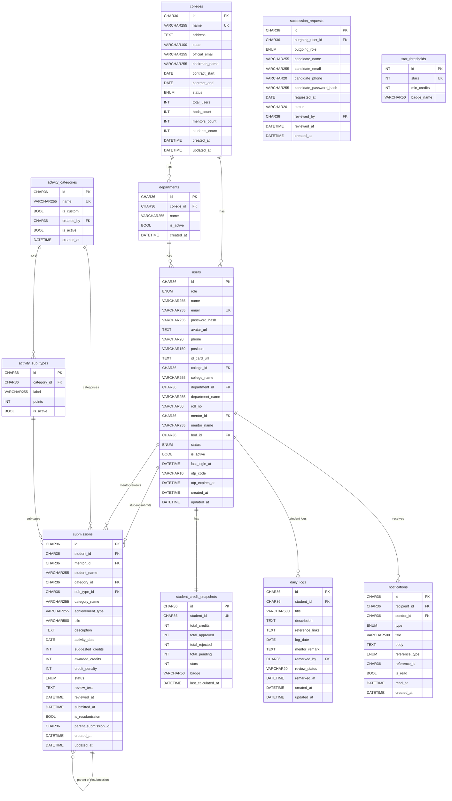

---

## 15. Non-Functional Requirements

| NFR ID | Category | Requirement | Status |
|---|---|---|---|
| NFR-001 | Security | JWT tokens shall not be stored in httpOnly cookies (current: localStorage) | Implemented (localStorage — see Security section) |
| NFR-002 | Security | Passwords shall be hashed using BCrypt before storage | Implemented |
| NFR-003 | Security | CSRF shall be disabled (stateless REST API) | Implemented |
| NFR-004 | Security | CORS origins shall be configurable via environment variable | Implemented (`ALLOWED_ORIGINS`) |
| NFR-005 | Performance | API responses for dashboard pages should complete in under 2 seconds (Proposed — not measured) | TBC |
| NFR-006 | Scalability | The backend is stateless (JWT, no server-side sessions) and horizontally scalable | Implemented |
| NFR-007 | Availability | The platform targets 99.5% uptime (SLA depends on Render/Supabase/MongoDB Atlas plans) | TBC |
| NFR-008 | Data Integrity | DB constraints enforce: awarded_credits = 0 on REJECTED submissions | Implemented |
| NFR-009 | Data Integrity | Roll number is unique per college (enforced by DB unique constraint) | Implemented |
| NFR-010 | Maintainability | Star thresholds are configurable in the database without code changes | Implemented |
| NFR-011 | Browser Compat | Application shall support modern Chromium, Firefox, and Safari browsers | TBC — no explicit compatibility tests found |
| NFR-012 | Accessibility | Application shall conform to WCAG 2.1 AA guidelines | TBC — not confirmed in codebase |
| NFR-013 | Privacy | Student personal data (name, email, roll no) shall not be exposed across colleges | Implemented (college-scoped queries) |
| NFR-014 | Logging | Application uses SLF4J/Logback for structured logging; log files in `backend/logs/` | Implemented |
| NFR-015 | Testing | Unit and integration test coverage is not visible in the inspected codebase | Gap — see Section 19 |

---

## 16. Security and Permissions

### 16.1 RBAC Matrix

| Endpoint Group | SYSTEM_ADMIN | COLLEGE_ADMIN | HOD | MENTOR | STUDENT |
|---|---|---|---|---|---|
| `/api/auth/**` (public) | ✓ | ✓ | ✓ | ✓ | ✓ |
| `/api/system-admin/**` | ✓ | ✗ | ✗ | ✗ | ✗ |
| `/api/college-admin/**` | ✗ | ✓ | ✗ | ✗ | ✗ |
| `/api/hod/**` | ✗ | ✗ | ✓ | ✗ | ✗ |
| `/api/mentor/**` | ✗ | ✗ | ✗ | ✓ | ✗ |
| `/api/student/**` | ✗ | ✗ | ✗ | ✗ | ✓ |
| `/api/notifications/**` | ✓ | ✓ | ✓ | ✓ | ✓ |
| `/api/submission/files/download` | Public | Public | Public | Public | Public |
| `/api/reviews/**` | Public | Public | Public | Public | Public |

### 16.2 Security Notes

> **⚠️ Important for Client:** JWT tokens are stored in `localStorage` on the frontend. This is acceptable for internal college management applications but may be a concern in high-security environments. The alternative (httpOnly cookies) would require backend changes. This should be confirmed with the client.

- Tokens expire after 24 hours (configurable).
- Session expiry triggers automatic redirect to login.
- All controller methods use Spring Security `@PreAuthorize("hasRole('X')")` annotations.
- File download is intentionally public (no auth) to allow direct download links.
- OTP codes are stored directly on the `users` table with an expiry timestamp.
- Candidate passwords in succession requests are BCrypt-hashed at storage time.

---

## 17. Deployment and Operational Considerations

### 17.1 Frontend Deployment

- **Platform:** Vercel
- **Build Command:** `npm run build` (Vite)
- **Output Directory:** `dist/`
- **SPA Routing:** `vercel.json` rewrites all routes to `index.html`
- **Environment:** VITE environment variables (API base URL must be configured)

### 17.2 Backend Deployment

- **Platform:** Render (Cloud PaaS)
- **Container:** Docker (multi-stage: Maven builder → Eclipse Temurin JRE 17 Alpine)
- **Port:** 10000 (Render default)
- **Memory:** Configured with `-Xmx400m` heap limit
- **Configuration:** Environment variables injected by Render at runtime (not committed to repo)

### 17.3 Database Deployment

| Database | Service | Notes |
|---|---|---|
| PostgreSQL | Supabase (Cloud) | Connection string in `PG_URL` env var with SSL |
| MongoDB | MongoDB Atlas (Cloud) | URI in `MONGO_URI` env var |

### 17.4 Environment Variables

| Variable | Purpose | Sensitive |
|---|---|---|
| `APP_ENV` | Environment mode (dev/prod) | No |
| `SERVER_PORT` | Backend port | No |
| `PG_URL` | PostgreSQL connection URL | **Yes** |
| `PG_USERNAME` | DB username | **Yes** |
| `PG_PASSWORD` | DB password | **Yes** |
| `MONGO_URI` | MongoDB connection string | **Yes** |
| `MONGO_DATABASE` | MongoDB database name | No |
| `JWT_SECRET` | JWT signing key | **Yes** |
| `JWT_EXPIRATION` | Token expiry in ms | No |
| `MAIL_HOST` | SMTP host | No |
| `MAIL_PORT` | SMTP port | No |
| `MAIL_USERNAME` | SMTP email address | **Yes** |
| `MAIL_PASSWORD` | SMTP app password | **Yes** |
| `ALLOWED_ORIGINS` | CORS allowed origins | No |

> ⚠️ **Security Note:** The `.env.example` file contains SMTP credentials. These should be rotated immediately and the `.env.example` file should only contain placeholder values.

---

## 18. Risks, Dependencies, Assumptions, and Constraints

### 18.1 Risks

| Risk | Severity | Likelihood | Mitigation |
|---|---|---|---|
| SMTP credentials exposed in `.env.example` | High | Confirmed | Rotate credentials immediately; update `.env.example` with placeholders only |
| JWT in localStorage susceptible to XSS | Medium | Low (if code hygiene maintained) | Add Content Security Policy headers; consider httpOnly cookies for future |
| MongoDB Atlas free-tier storage limits | Medium | Medium | Monitor usage; upgrade tier before hitting limits |
| No automated test suite visible | High | Confirmed | Implement unit + integration tests before production launch |
| `SubmissionController` TODOs incomplete | Low | Confirmed | CRUD delegation is through role controllers; minimal standalone functionality needed |

### 18.2 Assumptions

- The HOD role self-registers and awaits College Admin approval (confirmed by `PENDING` status flow, but the specific approval endpoint is not visible in `CollegeAdminController`).
- File storage for submission evidence uses MongoDB GridFS or equivalent document storage (confirmed by `MongoSubmissionFile` entity).
- The `review` module (`ReviewController`) is a separate testimonials/ratings feature, not the submission approval workflow.
- Multiple colleges are fully isolated; users from one college cannot see data from another.

### 18.3 Constraints

- Java 17 minimum; Spring Boot 3.2.x.
- Frontend assumes a modern browser with ES2022+ support.
- The backend heap is constrained to 400 MB on Render's free/starter tier.

---

## 19. Current Implementation Gaps

| Gap ID | Description | Severity | Component |
|---|---|---|---|
| GAP-001 | `SubmissionController` has only a file-download endpoint; no standalone CRUD. Submission creation/listing is correctly in `StudentController` and review in `MentorController` — this architecture is acceptable but the `SubmissionController` TODO comment suggests incomplete intent | Low | `SubmissionController.java` |
| GAP-002 | `withdrawSubmission` method defined in `SubmissionService` interface but no controller endpoint exposes it | Medium | `SubmissionService.java` |
| GAP-003 | HOD approval of mentor succession requests: no endpoint found in `HodController` for listing or actioning succession requests | High | `HodController.java` |
| GAP-004 | College Admin HOD request approvals: frontend route `/dashboard/college-admin/hod-requests` exists but no `CollegeAdminController` endpoint for HOD approval workflow | High | `CollegeAdminController.java` |
| GAP-005 | Mentor Student Approvals: frontend route `/dashboard/mentor/student-approvals` exists but no dedicated backend endpoint for mentor-level student approval | Medium | `MentorController.java` |
| GAP-006 | No automated unit or integration tests visible in the `src/test` directory | High | All modules |
| GAP-007 | SMTP credentials present in `.env.example` (should be placeholder-only) | High | `.env.example` |
| GAP-008 | The `ReviewController` (`/api/reviews`) is publicly accessible with no authentication; purpose and relationship to the main platform is unclear | Medium | `ReviewController.java` |
| GAP-009 | `StarThreshold` management endpoint for System Admin is not present (thresholds are seeded but cannot be updated via API) | Low | `SystemAdminController.java` |
| GAP-010 | Student dashboard has no paginated or filtered submission view (uses `page=0&size=1000` workaround) | Medium | `StudentController.java` |

---

## 20. Proposed Future Enhancements

> The following are **proposed** features not present in the current codebase. They are recommended based on the product vision and typical institutional requirements.

| Priority | Enhancement | Rationale |
|---|---|---|
| High | Automated activity report export (PDF/Excel) for AICTE/university audits | Direct regulatory compliance requirement for Indian institutions |
| High | HOD and College Admin approval endpoints for succession and HOD requests (GAP-003, GAP-004) | Required to complete existing workflows |
| High | Automated test suite (JUnit + Mockito for backend; React Testing Library for frontend) | Code quality and regression prevention |
| Medium | Submission withdrawal endpoint exposed via API (GAP-002) | Allows students to retract erroneous submissions |
| Medium | Paginated submission listing with filter/sort capabilities (by status, date, category) | Performance at scale with large student cohorts |
| Medium | Star threshold management API for System Admin | Enables threshold changes without database access |
| Medium | Placement readiness report generation per student | Bridges activity tracking to placement cell data |
| Low | Mobile-responsive PWA enhancements | Enables mobile access without native app development |
| Low | Role-to-role direct messaging / chat | Reduces out-of-band communication (WhatsApp/email) |
| Low | Multi-language support (regional Indian languages) | Wider adoption in vernacular-medium institutions |

---

## 21. Product Success Metrics

> These are **proposed targets**, not measured current values, unless explicitly noted.

| Metric | Proposed Target | Measurement Method |
|---|---|---|
| User Registration Success Rate | > 95% complete OTP verification within 24h | Auth service: register vs. verified count |
| Login Success Rate | > 99% for active accounts | Auth logs: successful vs. failed logins |
| Submission Review Turnaround | < 48 hours for 80% of submissions | submissions.reviewed_at - submitted_at |
| Monthly Active Students | > 70% of enrolled students submit ≥ 1 activity/month | submissions.submitted_at grouping |
| Mentor Approval Rate | Baseline to be established per college | Approved / total reviewed |
| API Error Rate | < 1% of all API calls return 5xx | Application logs |
| API Response Time (P95) | < 1.5 seconds for dashboard endpoints | Monitoring / APM (TBC) |
| Notification Delivery Rate | > 99% for in-app; > 95% for email | Notification records vs. SMTP delivery |

---

## 22. Open Questions for the Client

| Q ID | Question | Priority |
|---|---|---|
| Q-001 | Who approves HOD self-registrations — the College Admin or a dedicated workflow? | High |
| Q-002 | Should the succession approval for HOD role be handled by College Admin (as per entity comment) or System Admin? | High |
| Q-003 | Should JWT tokens be migrated from localStorage to httpOnly cookies for enhanced security? | High |
| Q-004 | What is the intended purpose of the `ReviewController` (`/api/reviews`)? Is this a public testimonials/ratings module? | Medium |
| Q-005 | Is the `SubmissionController` (`/api/submission`) intended to expose additional endpoints, or is the current delegation through role-specific controllers sufficient? | Medium |
| Q-006 | What are the regulatory requirements (AICTE/university) for data retention of activity records? | High |
| Q-007 | Should submission withdrawal be exposed to students? Under what conditions? | Medium |
| Q-008 | Are there performance SLAs (response times, uptime guarantees) required in the contract? | High |
| Q-009 | What backup and disaster recovery policies are required (especially for Supabase PostgreSQL)? | High |
| Q-010 | Should the platform support NAAC accreditation reports or only internal tracking? | Medium |
| Q-011 | Is there a requirement for the College Admin to manage department creation, or are departments pre-seeded? | High |
| Q-012 | Should the star thresholds (Bronze, Silver, etc.) be configurable per-college or system-wide only? | Low |

---

## 23. Glossary and Appendices

### 23.1 Glossary

| Term | Definition |
|---|---|
| SAPT | Student Activity Point Tracker — the internal project name for SPAT |
| SPAT | Student Activity & Performance Tracker — the product name |
| OTP | One-Time Password — a time-limited code sent to a user's email for verification |
| JWT | JSON Web Token — a stateless authentication token signed with a secret key |
| RBAC | Role-Based Access Control — access to features is determined by the user's role |
| Credit | A numerical point awarded to a student upon approval of an activity submission |
| Star Level | A gamified achievement level (0–5 stars / Beginner to Diamond) based on accumulated credits |
| Submission | A student's application for activity points, containing evidence, category, and description |
| Snapshot | A pre-computed summary of a student's credit totals, stored in `student_credit_snapshots` |
| Succession | The process of transferring a mentor's or HOD's account to an incoming faculty member |
| HOD | Head of Department |
| PRD | Product Requirements Document |
| FR | Functional Requirement |
| NFR | Non-Functional Requirement |
| TBC | To Be Confirmed — information that requires client confirmation |
| Multi-tenant | A single platform instance serving multiple independent colleges with data isolation |
| Supabase | A cloud PostgreSQL hosting service used as the primary database |
| Render | A cloud platform-as-a-service used to host the Docker-containerised Spring Boot backend |
| Vercel | A cloud deployment platform used to host the React frontend |

### 23.2 File Structure Reference

```
SPAT/
├── src/                          ← React frontend
│   ├── pages/
│   │   ├── Auth/                 ← LoginPage, RegisterPage
│   │   ├── Home/                 ← Public landing/help page
│   │   └── Dashboards/
│   │       ├── SystemAdmin/
│   │       ├── CollegeAdmin/
│   │       ├── HOD/
│   │       ├── Mentor/
│   │       └── Student/
│   ├── components/               ← Sidebar, Navbar, UI components
│   ├── context/                  ← AuthContext, ThemeContext
│   ├── routes/                   ← AppRouter, ProtectedRoute
│   └── utils/                    ← API helpers, localStorage utilities
├── backend/
│   └── src/main/java/com/sapt/
│       ├── auth/                 ← Authentication module
│       ├── collegeadmin/         ← College Admin module
│       ├── hod/                  ← HOD module
│       ├── mentor/               ← Mentor module
│       ├── student/              ← Student module
│       ├── submission/           ← Submission pipeline
│       ├── review/               ← Testimonials/ratings module
│       ├── notification/         ← In-app + email notifications
│       ├── security/             ← JWT, Spring Security config
│       ├── common/               ← Enums, exceptions, response wrappers
│       └── config/               ← CORS, MongoDB, Async configs
├── docs/prd/                     ← This document and related deliverables
└── vercel.json                   ← Vercel SPA routing config
```
