# SPAT — Workflows and Architecture
## Detailed Workflows, Sequence Diagrams, and Architecture Reference

---

| Document | SPAT Workflows and Architecture |
|---|---|
| Version | 1.0 |
| Date | October 2026 |

---

## Section 1: System Architecture Diagrams

### 1.1 Cloud Deployment Architecture

```mermaid
graph TB
    subgraph "User Devices"
        U1["Student Browser"]
        U2["Mentor Browser"]
        U3["HOD/Admin Browser"]
    end

    subgraph "Vercel CDN (Frontend)"
        FE["React 19 SPA<br/>Built with Vite<br/>Styled with Tailwind CSS<br/>vercel.json SPA rewrites"]
    end

    subgraph "Render (Backend)"
        BE["Spring Boot 3.2.5<br/>Docker Container<br/>JRE 17 Alpine<br/>Port 10000<br/>-Xmx400m"]
        SV["Spring Security<br/>JWT Auth Filter<br/>CORS (configured origins)"]
    end

    subgraph "Supabase (Primary DB)"
        PG["PostgreSQL<br/>SSL Required<br/>Tables: users, colleges,<br/>departments, submissions,<br/>daily_logs, notifications,<br/>succession_requests, etc."]
    end

    subgraph "MongoDB Atlas (Secondary DB)"
        MG["MongoDB Cluster<br/>Collections:<br/>submission_files (blobs)<br/>sapt_logs (audit trail)"]
    end

    subgraph "Google Workspace"
        SM["Gmail SMTP<br/>Port 587 (TLS)<br/>OTP Emails<br/>Notification Emails"]
    end

    U1 & U2 & U3 -->|HTTPS| FE
    FE -->|HTTPS + JWT Bearer| BE
    BE --> SV
    BE -->|Spring Data JPA / JDBC| PG
    BE -->|Spring Data MongoDB| MG
    BE -->|Spring Mail (Async)| SM
```

### 1.2 Backend Internal Architecture

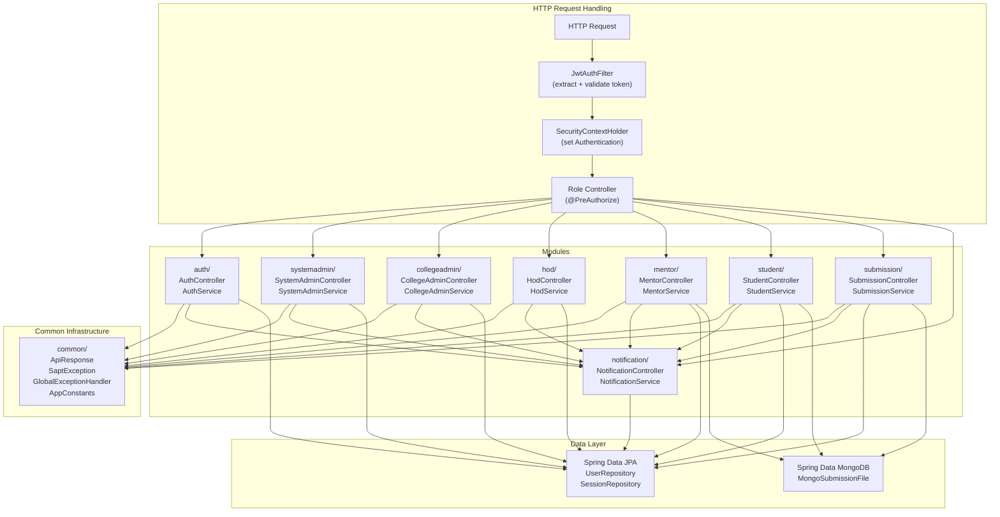

### 1.3 Frontend Architecture

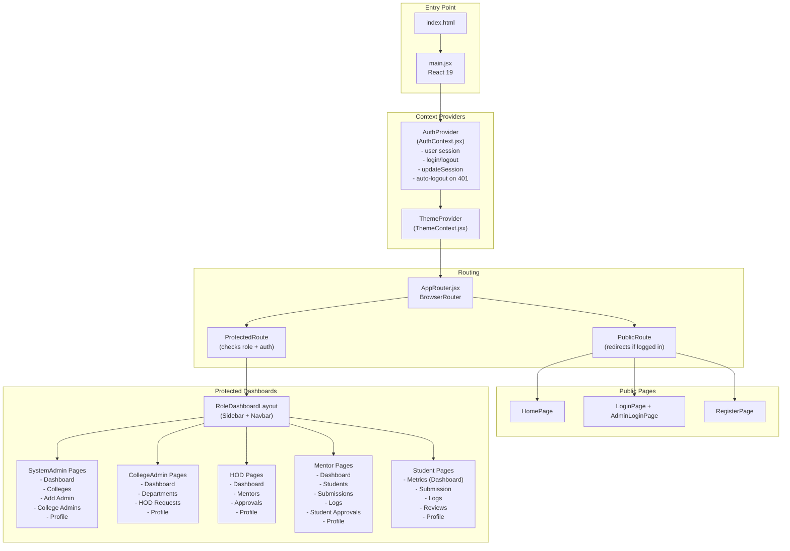

### 1.4 Entity Relationship Diagram (Abridged)

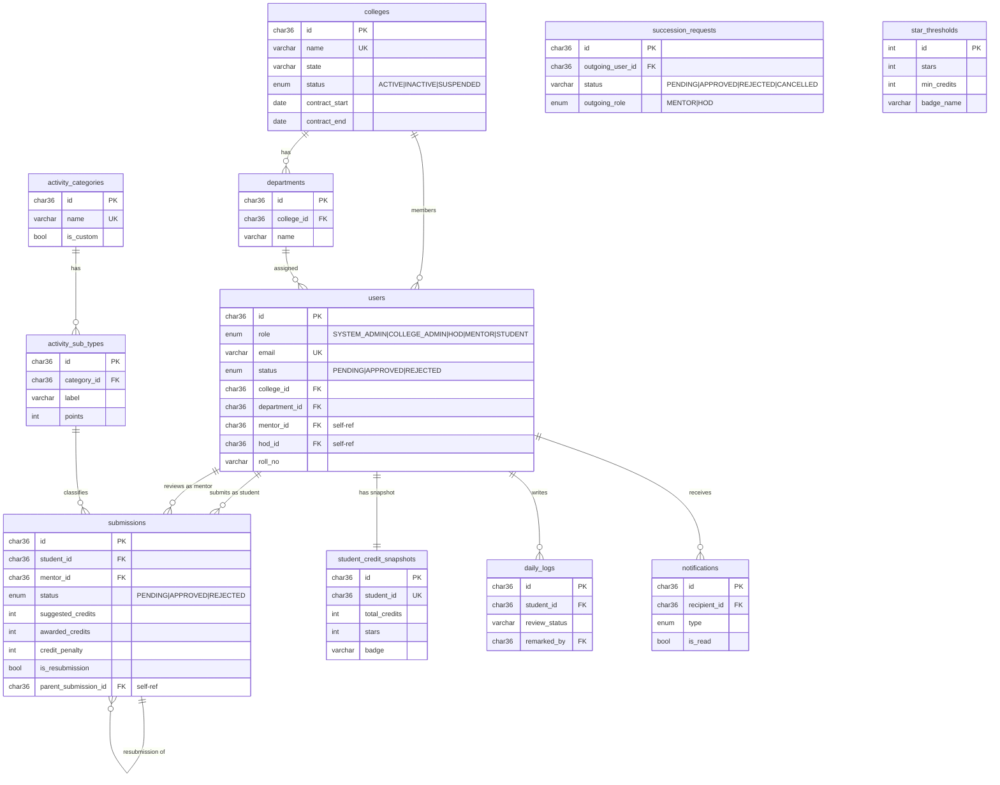

---

## Section 2: Detailed Workflow Diagrams

### Workflow 1: Complete Authentication Flow

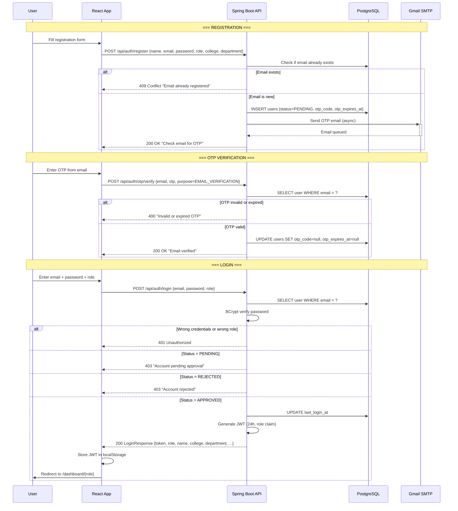

### Workflow 2: Complete Submission Lifecycle

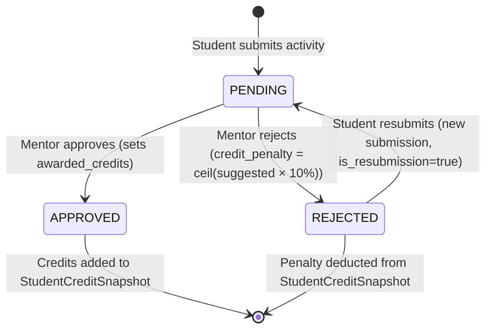

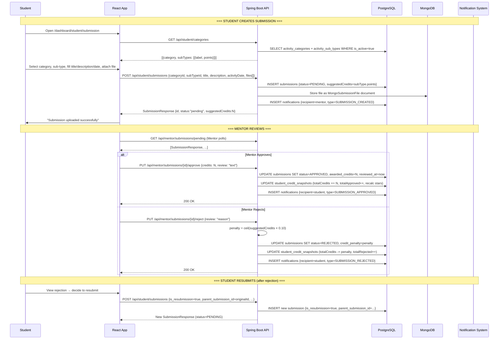

### Workflow 3: Password Reset Flow

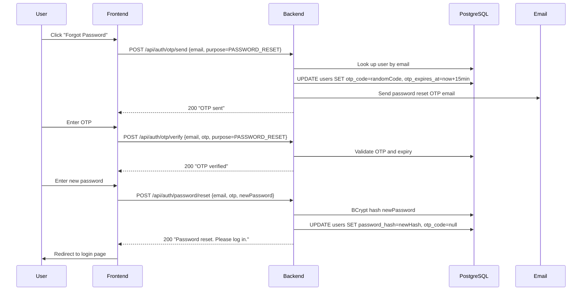

### Workflow 4: Mentor Succession Handover

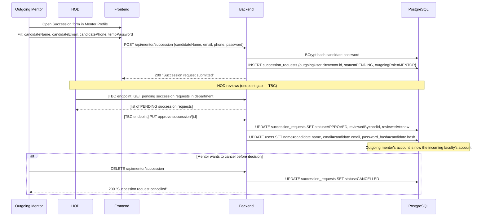

### Workflow 5: HOD Approves a Mentor Registration

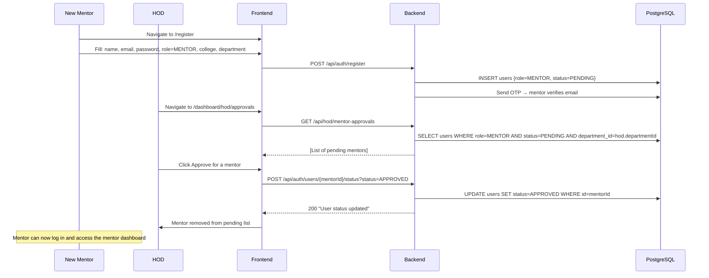

### Workflow 6: Student Earns Star Badge

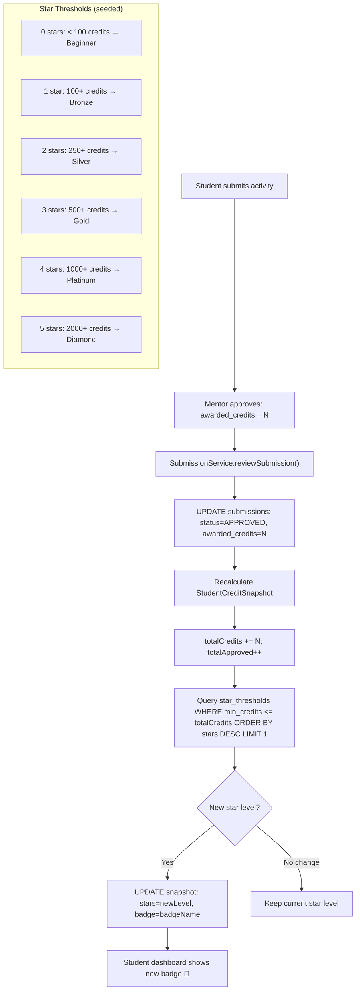

### Workflow 7: System Admin Onboards a College

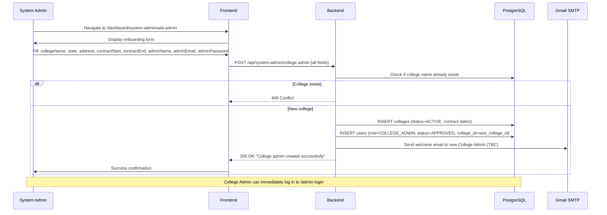

---

## Section 3: Data Flow Reference

### 3.1 Frontend → Backend Data Flow

```
Browser Request
    ↓
React Component (e.g., MentorDashboard.jsx)
    ↓
API call via utils/api.js (adds JWT Authorization header)
    ↓
Spring Boot JwtAuthFilter
    ├── Extract token from "Authorization: Bearer {token}"
    ├── Validate signature and expiry (JwtUtil)
    └── Set SecurityContext (email as username, ROLE_X as authority)
    ↓
Controller method (e.g., MentorController.getDashboardStats)
    ├── @PreAuthorize("hasRole('MENTOR')") — enforced
    └── @AuthenticationPrincipal UserDetails → userDetails.getUsername() = email
    ↓
Service layer (e.g., MentorService.getDashboardStats)
    ├── Resolve email → User entity via UserRepository
    └── Business logic + database queries
    ↓
Repository layer (Spring Data JPA / MongoDB)
    ↓
PostgreSQL (Supabase) or MongoDB (Atlas)
    ↓
Response wrapped in ApiResponse<T> { success, message, data, timestamp }
    ↓
React component renders data
```

### 3.2 API Response Format

All API responses use a consistent wrapper:

```json
{
  "success": true,
  "message": "Dashboard stats fetched successfully",
  "data": { ... },
  "timestamp": "2026-10-27T22:53:12"
}
```

Error responses:
```json
{
  "success": false,
  "message": "Invalid OTP or OTP has expired",
  "data": null,
  "timestamp": "2026-10-27T22:53:12"
}
```

### 3.3 JWT Token Structure

```json
Header: { "alg": "HS256", "typ": "JWT" }
Payload: {
  "sub": "user@example.com",   ← email (used as username in Spring Security)
  "role": "ROLE_MENTOR",
  "iat": 1730050000,
  "exp": 1730136400            ← iat + 86400 seconds (24 hours)
}
Signature: HMAC-SHA256(base64url(header) + "." + base64url(payload), JWT_SECRET)
```

### 3.4 Authentication Principal Resolution

> **Important architectural note:** `UserDetails.getUsername()` in SAPT returns the user's **email address** (not UUID). Controllers that need the user's UUID must look up the User entity via `UserRepository.findByEmail(email)`. This pattern is used across all controllers.

```java
// Pattern used across all controllers:
String email = userDetails.getUsername();       // email
User user = userRepository.findByEmail(email);  // resolve to User entity
String userId = user.getId();                   // get UUID
```

---

## Section 4: Environment and Configuration Reference

### 4.1 Backend Profiles

| Profile | File | Use |
|---|---|---|
| default | `application.properties` | Common config, reads from .env |
| dev | `application-dev.properties` | Development overrides |
| prod | `application-prod.properties` | Production overrides |

### 4.2 Application Configuration Key Points

- **Context path:** `/api` (all endpoints prefixed with `/api/`)
- **CORS:** Origins from `ALLOWED_ORIGINS` env var
- **JPA:** Auto-DDL configured for schema creation/update
- **MongoDB:** Configured for `sapt_logs` database
- **Async:** `@Async` used for email sending (non-blocking)
- **Logging:** SLF4J + Logback; log files stored in `backend/logs/`

### 4.3 Frontend Route Map

| Route | Component | Access Control |
|---|---|---|
| `/` | HomePage | Public |
| `/login` | LoginPage | Public (redirects if logged in) |
| `/admin-login` | AdminLoginPage | Public (redirects if logged in) |
| `/register` | RegisterPage | Public (redirects if logged in) |
| `/dashboard/system-admin` | SystemAdminAnalyticsDashboard | SYSTEM_ADMIN only |
| `/dashboard/system-admin/colleges` | SystemAdminColleges | SYSTEM_ADMIN only |
| `/dashboard/system-admin/add-admin` | SystemAdminAddAdmin | SYSTEM_ADMIN only |
| `/dashboard/system-admin/college-admins` | SystemAdminCollegeAdmins | SYSTEM_ADMIN only |
| `/dashboard/system-admin/profile` | SystemAdminProfile | SYSTEM_ADMIN only |
| `/dashboard/college-admin` | CollegeAdminDashboard | COLLEGE_ADMIN only |
| `/dashboard/college-admin/departments` | CollegeAdminDepartments | COLLEGE_ADMIN only |
| `/dashboard/college-admin/hod-requests` | CollegeAdminHODRequests | COLLEGE_ADMIN only |
| `/dashboard/college-admin/profile` | CollegeAdminProfile | COLLEGE_ADMIN only |
| `/dashboard/hod` | HODDashboard | HOD only |
| `/dashboard/hod/mentors` | HODMentors | HOD only |
| `/dashboard/hod/approvals` | HODMentorApprovals | HOD only |
| `/dashboard/hod/profile` | HODProfile | HOD only |
| `/dashboard/mentor` | MentorDashboard | MENTOR only |
| `/dashboard/mentor/students` | MentorStudents | MENTOR only |
| `/dashboard/mentor/submissions` | MentorSubmissions | MENTOR only |
| `/dashboard/mentor/logs` | MentorLogs | MENTOR only |
| `/dashboard/mentor/student-approvals` | MentorStudentApprovals | MENTOR only |
| `/dashboard/mentor/profile` | MentorProfile | MENTOR only |
| `/dashboard/student` | StudentMetrics | STUDENT only |
| `/dashboard/student/submission` | StudentSubmission | STUDENT only |
| `/dashboard/student/logs` | StudentLogs | STUDENT only |
| `/dashboard/student/reviews` | StudentReviews | STUDENT only |
| `/dashboard/student/profile` | StudentProfile | STUDENT only |
| `*` (catch-all) | Redirect to `/` | — |
